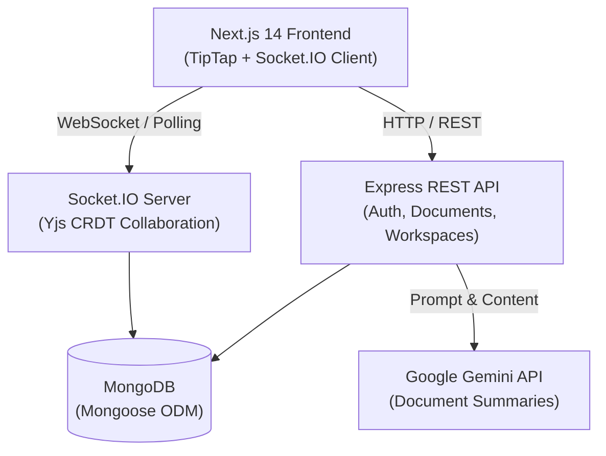

# SyncSpace

<p align="center">
  <strong>A modern, real-time collaborative workspace for teams and individuals.</strong><br>
  Combining rich-text block editing, CRDT real-time sync, multi-tenant workspaces, granular sharing, and AI document summarization.
</p>

<p align="center">
  
  
  
  
  
  
  
  
</p>

---

## 🌟 Key Features

### 📝 Block-Based Rich-Text Editing
- Powered by **TipTap** and **ProseMirror** with structured document schema.
- Markdown keyboard shortcuts (`#`, `*`, `[]`, `>`, `-`).
- Support for headings (H1–H3), bold, italic, underline, strikethrough, inline code, blockquotes, bullet lists, ordered lists, task checkboxes, code blocks, tables, and radiant high-contrast highlights.
- Real-time word and character counters.

### ⚡ Real-Time Collaboration & Presence
- Low-latency concurrent synchronization powered by **Yjs CRDTs** over **Socket.IO**.
- Dynamic active collaborator avatars and presence indicators in the document header.
- Conflict-free resolution ensuring concurrent edits never overwrite each other.

### 💾 Bulletproof Persistence & Autosave
- Debounced autosave mechanism with visual state feedback (`Saved`, `Saving...`, `Error`).
- Document snapshots and version state saved cleanly to MongoDB.

### 🏢 Workspaces & Access Control
- **Personal Space**: Automatically created on registration for private note-taking.
- **Team Workspaces**: Create custom shared spaces and invite team members by email.
- **Role-Based Permissions**: Granular roles (`Owner`, `Editor`, `Viewer`) enforcing permissions across all APIs and real-time sockets.
- **Document Sharing**: Individual document access overrides, public view-only links, and instant access revocation.

### 🤖 AI Document Summarization
- Integrated with **Google Gemini 3.5 Flash** for document comprehension.
- One-click summaries with customizable outputs:
  - **TL;DR**: Quick snapshot of the core message.
  - **Executive Summary**: Structured overview highlighting key takeaways.
  - **Action Items**: Extracted tasks, checklists, and next steps.

### 🔍 Unified Search & File Management
- Permission-aware instant search across document titles and content.
- Favorites, recently viewed docs, nested documents, and Trash with one-click restore.
- Attachment management with safe type filtering and size enforcement.

---

## 🏗️ Architecture



---

## 🛠️ Tech Stack

| Layer | Technologies |
|---|---|
| **Frontend** | Next.js 14 (App Router), React 18, TipTap Editor, Tailwind CSS, Zustand, Axios, Lucide Icons |
| **Backend** | Node.js, Express, Socket.IO, Yjs, Mongoose, Helmet, Compression, Express-Validator, Winston |
| **Database** | MongoDB (Atlas or local replica set) |
| **AI** | Google Gemini API (`@google/generative-ai`) |
| **DevOps & Deploy** | Docker, Docker Compose, Alpine Linux multi-stage builds, Render Blueprint, Vercel |

---

## 🚀 Getting Started (Local Development)

### Prerequisites
- **Node.js**: v20 or newer
- **npm**: v10 or newer
- **MongoDB**: A running local instance (`mongodb://localhost:27017`) or a free [MongoDB Atlas](https://www.mongodb.com/atlas) cluster URI

---

### 1. Clone the Repository
```bash
git clone https://github.com/cAptA1n-bot/syncspace.git
cd syncspace
```

### 2. Configure Environment Variables

#### Backend:
Copy the example file and update values:
```bash
cp SyncSpace/backend/.env.example SyncSpace/backend/.env
```
Key backend variables (`SyncSpace/backend/.env`):
```env
PORT=3000
NODE_ENV=development
MONGODB_URI=mongodb://127.0.0.1:27017/syncspace
JWT_SECRET=your_super_secret_jwt_key_at_least_64_characters_long
CLIENT_URL=http://localhost:5173
COOKIE_SECURE=false
COOKIE_SAME_SITE=lax

# Optional: Google Gemini API Key for Document Summarization
AI_PROVIDER=gemini
AI_API_KEY=your_google_gemini_api_key
```

#### Frontend:
Copy the example file and update values:
```bash
cp SyncSpace/frontend/.env.example SyncSpace/frontend/.env
```
Key frontend variables (`SyncSpace/frontend/.env`):
```env
NEXT_PUBLIC_API_BASE_URL=http://localhost:3000
NEXT_PUBLIC_SOCKET_URL=http://localhost:3000
```

---

### 3. Install Dependencies & Start

In two separate terminals:

**Terminal 1 — Backend:**
```bash
cd SyncSpace/backend
npm install
npm run dev
# Server will start on http://localhost:3000
```

**Terminal 2 — Frontend:**
```bash
cd SyncSpace/frontend
npm install
npm run dev
# Next.js app will start on http://localhost:5173
```

Open your browser and navigate to `http://localhost:5173`.

---

## 🐳 Running with Docker Compose

Run the entire application (MongoDB, Backend, and Frontend) in one command:

```bash
docker compose up -d --build
```

- **Frontend**: Accessible at [http://localhost:5173](http://localhost:5173)
- **Backend API**: Accessible at [http://localhost:3000](http://localhost:3000)
- **MongoDB**: Running on port `27017` with persistent named volume `mongo_data`

To view logs or stop the containers:
```bash
docker compose logs -f
docker compose down
```

---

## 🌐 Cloud Deployment

Detailed step-by-step instructions for all hosting platforms are available in [**`DEPLOYMENT.md`**](./DEPLOYMENT.md).

### Quick Deployment Setup:

1. **Database**: Create a free database on [MongoDB Atlas](https://www.mongodb.com/atlas).
2. **Backend (Render)**:
   - Deploy as a **Web Service** or use the included [`render.yaml`](./render.yaml).
   - Set environment variables (`MONGODB_URI`, `JWT_SECRET`, `CLIENT_URL=https://<your-vercel-app>.vercel.app`, `AI_API_KEY`).
3. **Frontend (Vercel)**:
   - Connect the repository on [Vercel](https://vercel.com) and set Root Directory to `SyncSpace/frontend`.
   - Add `NEXT_PUBLIC_API_BASE_URL` and `NEXT_PUBLIC_SOCKET_URL` set to your Render backend URL.
   - Deploy.

---

## 📡 Core API Reference

| Method | Endpoint | Description | Auth Required |
|---|---|---|---|
| `POST` | `/api/auth/register` | Register a new user & create personal workspace | ❌ |
| `POST` | `/api/auth/login` | Authenticate user & issue JWT cookie/token | ❌ |
| `GET` | `/api/auth/me` | Fetch authenticated user profile | ✅ |
| `GET` | `/api/workspaces` | List all accessible workspaces | ✅ |
| `POST` | `/api/workspaces` | Create a new team workspace | ✅ |
| `POST` | `/api/workspaces/:id/members` | Invite member by email (`editor` / `viewer`) | ✅ |
| `GET` | `/api/documents` | List documents (with filters: favorites, trash) | ✅ |
| `POST` | `/api/documents` | Create a new document in a workspace | ✅ |
| `GET` | `/api/documents/:id` | Get document metadata and content | ✅ |
| `PUT` | `/api/documents/:id/content` | Autosave document block content | ✅ |
| `DELETE` | `/api/documents/:id` | Move document to trash | ✅ |
| `POST` | `/api/documents/:id/restore` | Restore document from trash | ✅ |
| `POST` | `/api/ai/summarize` | Generate AI summary with Gemini | ✅ |
| `GET` | `/health` | Server health status probe | ❌ |

---

## 📁 Repository Structure

```
SyncSpace-Project/
├── DEPLOYMENT.md              # Production deployment manual
├── README.md                  # Project documentation
├── docker-compose.yml         # Multi-container orchestration
├── render.yaml                # Render cloud blueprint
├── SyncSpace/
│   ├── backend/               # Node.js + Express + Socket.IO backend
│   │   ├── Dockerfile         # Production Alpine Dockerfile
│   │   ├── src/
│   │   │   ├── config/        # Database & storage config
│   │   │   ├── controllers/   # Express route handlers
│   │   │   ├── middleware/    # Auth, error handling, rate limiting
│   │   │   ├── models/        # Mongoose data models
│   │   │   ├── routes/        # REST API route definitions
│   │   │   ├── services/      # Business logic (AI, Auth, Documents)
│   │   │   ├── sockets/       # Socket.IO & Yjs real-time collaboration
│   │   │   ├── app.js         # Express application setup
│   │   │   └── server.js      # Server entry point & graceful shutdown
│   │   └── tests/             # Jest & Supertest automated test suites
│   │
│   └── frontend/              # Next.js 14 App Router frontend
│       ├── Dockerfile         # Standalone production Dockerfile
│       ├── app/               # Next.js App Router pages
│       ├── components/        # UI components (TipTap Editor, Modals, Nav)
│       ├── context/           # AuthContext & WorkspaceContext
│       ├── lib/               # Axios API client & Socket.IO client
│       └── next.config.js     # Next.js configuration (standalone output)
```

---

## 🛡️ Security & Privacy

- **Safe Credential Storage**: Passwords hashed with `bcryptjs` (salt rounds: 12).
- **Hardened Cookies**: HTTP-only, `SameSite`, and TLS `secure` flag toggles for production.
- **Data Protection**: Inputs validated on the server via `express-validator` and sanitized with `express-mongo-sanitize` to block NoSQL injection.
- **Rate Limiting**: Global and endpoint-specific rate limiters preventing brute-force attacks.
- **Zero AI Storage**: Source document contents are transmitted securely to Google Gemini for real-time summarization without third-party data retention.

---

## 📄 License

This project is licensed under the [MIT License](LICENSE).

